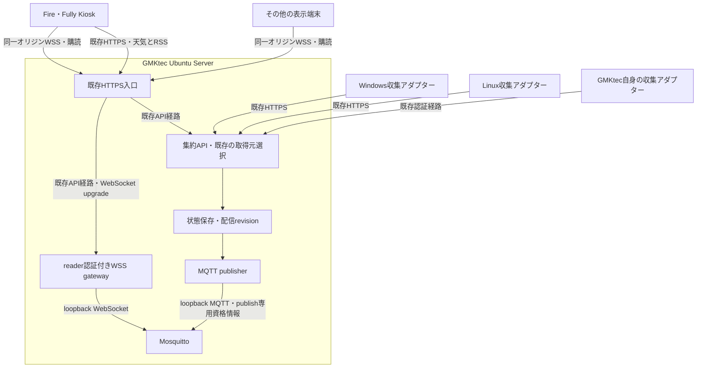

# GMKtec母艦によるusage集約・MQTT配信 計画書

本書はFire DashboardのGMKtec母艦・MQTT配信設計と段階導入計画の正本。
参照時期: 実装着手前、Phase 0調査時、配備・切り戻し時。
関連: [監査記録](2026-10-15-gmktec-mqtt-usage-plan-audit.md)、[配備・認証](../deployment.md)。
ホスト正本: `/home/otsune/docs/notes/fire-dashboard-deployment.md`、`/home/otsune/docs/services.md`。
作成: 2026-10-14／改訂: 2026-10-15（Asia/Tokyo）。対象: Fire Dashboard。
状態: 監査§19の指摘まで反映した計画案。アプリケーション実装・本番設定は未変更。

## 1. 目的と決定事項

GMKtec Ubuntu Serverを常時稼働する母艦とし、Windows／Linuxで収集したAIサービスのusageを集約する。集約後の表示用データをMQTTで配信し、Fireタブレットなどの表示端末で受信する。

ユーザーが指定した要件:

- usageの収集・集計はWindows／Linux側で行う。
- 表示端末へMQTTでusage値を送信する。
- 現環境の母艦はGMKtec Ubuntu Serverとする。

本計画の推奨設計:

- 収集元PCから母艦への既存HTTPS送信を維持する。
- 母艦の集約サービスを表示値の唯一の決定元とする。
- 母艦にMosquittoを配置し、集約サービスからpublishする。
- Fireのブラウザー／Fully KioskはMQTT over WSSでsubscribeする。
- 天気・RSS・地域設定・時計・時報は既存経路を維持する。
- HTTP表示を切り戻し経路として残し、端末単位で段階移行する。

「集計」は同一アカウントの使用率を足し合わせる処理ではない。同一アカウントを複数PCで観測した場合、既存の取得元選択規則を使い、最新の有効な観測を採用する。別アカウントの併記・合算は初期範囲に含めない。

## 2. 現状と根拠

リポジトリの実装とホストの配備記録を確認し、2026-10-15の監査による読み取り専用実測を参照した。本改訂では3つの収集wrapperと単発送信スクリプトを確認し、共有sender・Codexサービス・3つの収集timerの有効化／稼働状態を `systemctl --user show` で再測定した。ポート・Serve・Fireの状態は再測定していない。設定ファイルの内容、稼働状態の実測、将来のMQTT配信頻度の試算を区別する。

監査時点の入口は `https://gmktec.taila8b10.ts.net:8444`（tailnet only）。Tailscale Serveが `/` を `apps/dashboard/dist` へ、`/api` を `http://127.0.0.1:18787/api` へ中継する。APIは `fire-dashboard-api.service` で管理される。配備記録と監査を現状の参照元とし、サービス台帳にはAPI・Serve対応の記載漏れがあるため、導入前に整合させる。

`docs/acceptance.md`にはFire／Fully Kiosk（Android 9、WebView Chrome 138）で実配信を表示した記録がある。HTTPS表示の到達性には既存の検証記録があるが、MQTT over WSSは未検証である。

| 領域       | 現状                                                                    | 計画への影響                         |
| ---------- | ----------------------------------------------------------------------- | ------------------------------------ |
| 収集       | Claude、Codex、Antigravity、OpenCode Go、Hermes／Nous用アダプターがある | 既存の収集処理を再利用する           |
| PC→母艦    | HTTPS `POST /api/v1/usage`、PCごとの認証とsourceAlias                   | 初期段階で変更しない                 |
| 集約       | sequence検査、重複照合、取得元選択、最後の正常値保持がある              | MQTT側に同じロジックを複製しない     |
| 保存       | 集約サービスが状態をファイルへ保存する                                  | 配信revisionも同じ保存単位に追加する |
| 表示       | `/api/v1/dashboard`を30秒ごとに取得する                                 | usageだけ購読経路を追加する          |
| キャッシュ | IndexedDBへの保存と復元がある                                           | 保存値に配信の順序情報を付ける       |
| データ契約 | Zodによるusage率・残高・時刻・状態の検証がある                          | MQTT受信でも検証を必須とする         |
| MQTT       | package.jsonにMQTTクライアント依存はない                                | 新規依存とビルド対応が必要           |

参照:

- [README](../../README.md)
- [収集手順](../collectors.md)、[追加サービス](../provider-usage.md)
- [配備・認証](../deployment.md)
- [表示データ取得](../../apps/dashboard/src/data/client.ts)
- [集約](../../services/aggregator/src/usage/ingest.ts)
- [状態保存](../../services/aggregator/src/store.ts)
- [共通契約](../../packages/contracts/src/index.ts)

## 3. 方式比較

| 案  | 構成                         | 利点                                 | 負担・制約                                         | 判断           |
| --- | ---------------------------- | ------------------------------------ | -------------------------------------------------- | -------------- |
| A   | 各PC→HTTPS集約→MQTT→端末     | 既存の認証・集約・保存を再利用できる | HTTPSとMQTTの運用が必要                            | 採用案         |
| B   | 各PC→MQTT→母艦集約→MQTT→端末 | 収集経路もMQTTに統一できる           | 全PCの送信、認証、ACL、再送方式の変更が必要        | 将来検討       |
| C   | 母艦→MQTT→HTTP中継→端末      | 端末側にMQTT実装が不要               | 端末のMQTT受信という要件から外れ、ポーリングも残る | 初期採用しない |

## 4. 全体構成



端末の第一候補は同一オリジンの `/api/v1/usage/stream` とする。既存Serveの `/api` 中継と、aggregatorのloopback HTTP listenerを共有するgatewayルートでWSSを受ける。既存経路でupgrade・パス・認証ヘッダーの転送が成立すれば、Serveの経路追加とそのsudo変更は不要になる。ブローカーのMQTT／WS用新規リスナーはホストloopbackへ限定し、ポートはPhase 0で確定する。

既存経路で要件を満たせない場合のみ、独立した `/mqtt` 中継を代替案として評価する。その採用にはsystem側の `sudo tailscale serve` 設定変更が伴うため、Phase 5で差分・承認・バックアップ・切り戻しを独立して扱う。経路成立は未検証であり、第一候補の採用を確認済みとはしない。

GMKtec停止時は集約と配信が停止する。初期構成は単一母艦であり、ブローカーのクラスタ化や母艦の冗長化は範囲外とする。端末は保存値を更新停止表示付きで維持し、時計など端末内で動く機能を継続する。

## 5. コンポーネントの責務

### 5.1 収集元PC

- 各サービスへログイン済みのPCで既存アダプターを実行する。
- APIキー、セッション、会話、プロンプト、作業パスを表示用配信に含めない。
- 既存の送信間隔、ハートビート、失敗時の再送規則を維持する。
- Windowsのタスクスケジューラ、Linuxのsystemdなど既存の常駐方法を利用する。
- PCのスリープや停止を前提とし、再開後の古いsnapshotを新しい観測として扱わない。

### 5.2 母艦の集約サービス

- 既存の認証・sourceAlias許可・sequence検査後にデータを保存する。
- providerごとの表示値は既存のingestorが決める。
- 全providerの表示用usageを一つの配信スナップショットとして生成する。
- 保存が成功した状態だけをpublish対象とする。
- MQTT停止によってusage受信APIを失敗させない。MQTT接続処理をHTTP要求の完了条件にしない。
- 集約の失敗と配信の失敗を別の状態・ログとして記録する。

### 5.3 MQTT publisher

- 集約サービス内の独立したモジュールとし、送信処理をingestorへ埋め込まない。
- 有効時のみ起動し、無効時はMQTTなしで従来どおり稼働する。
- 状態保存後の通知を受け、最新の確定状態をpublishする。
- ブローカー切断時は指数バックオフとjitterで再接続する。初期案は1秒から最大60秒。
- 切断中の全履歴をキューに積まず、最新状態一つにまとめる。
- 起動・再接続時は保存済み最新状態を再送する。
- 通常の状態送信とは別に60秒ごとの配信ハートビートを送る。
- 終了時は可能な範囲でofflineを送信し、異常終了にはLWTを用いる。

### 5.4 表示端末

- ローカルに同梱したMQTTクライアントを用いる。CDNへの実行時依存を追加しない。
- MQTT v3.1.1、QoS 1、clean sessionで開始する。最新状態の表示に永続セッションの履歴配送は不要。
- 接続ごとに衝突しないclientIdを生成し、他端末・他タブを切断しない。
- WebSocketでは `mqtt` サブプロトコルを要求し、gateway・Mosquitto間を含むネゴシエーション結果が `mqtt` であることを確認する。詳細は§9.2。
- usage購読・検証・再接続は専用データモジュールへ分離する。
- 時計、時報、天気、RSSの状態とは独立して接続状態を持つ。
- ページ復帰時は接続を再評価し、retained値とハートビートで状態を回復する。

## 6. MQTTトピックと配送

初期環境のトピック接頭辞を `fire-dashboard/v1/main` とする。試験環境は別接頭辞・別ACLにする。

| トピック                                    | 内容                            | QoS | retain |
| ------------------------------------------- | ------------------------------- | --- | ------ |
| `fire-dashboard/v1/main/usage/state`        | 全providerの表示用usage         | 1   | true   |
| `fire-dashboard/v1/main/usage/availability` | publisherのonline／offline、LWT | 1   | true   |
| `fire-dashboard/v1/main/usage/heartbeat`    | publisherの生存確認             | 1   | false  |

全providerを一つにまとめることで、取得元切替やprovider削除を一貫した状態として配信する。providerごとの細分化は初期範囲に含めない。

retained値は新規接続時の初期表示に使う。ブローカーの保存機能を有効にするが、retained値の存在だけでは鮮度を保証しない。集約サービスの状態ファイルを正本とし、ブローカーのデータ消失時には再publishして復旧する。

`too_large` を通知するheartbeatもretain:falseであり、接続前のエラー通知は新規端末へ再配信されない。古いretained stateだけで最新と判定せず、初回HTTP取得で現在revisionを照合し、その後のheartbeatで配信状態を確認する。HTTPにも未接続なら保存値／retained値を未確認の参考値として表示する。

## 7. 配信データ契約と順序

既存の `Usage` を再利用し、配送用envelopeを追加する。次は構造例であり、実装前に共通スキーマとfixtureで固定する。

```ts
type UsageDelivery = {
  schemaVersion: 1;
  streamId: string;
  revision: string;
  publishedAt: string;
  usage: Usage[];
};
```

| フィールド    | 規則                                                                    |
| ------------- | ----------------------------------------------------------------------- |
| `streamId`    | 状態系列の識別子。通常の再起動では保持する                              |
| `revision`    | 単調増加する非負整数の10進文字列。長さを制限し、BigIntなどで比較する    |
| `publishedAt` | 母艦で配信envelopeを作成したUTC時刻。usageの観測時刻へ転記しない        |
| `usage`       | 既存Usageの配列。既知providerを各1件、最大5件。未知・重複providerは拒否 |

従来案の256 KiBは撤回する。既存の上限は、usage受信APIが1リクエスト64 KiB（Fastify `bodyLimit: 65536`）、HTTP表示クライアントがレスポンス文字列長 `2 * 1024 * 1024`、Zod契約が配列数・文字列長ごとの制約であり、同じ制約ではない。各64 KiBに近い5 providerだけでも256 KiBを超え得る。エラー時の正常値保持や再直列化もあるため、64 KiB×5を厳密な集約上限とは扱わない。

サイズ方針は「MQTTをHTTPより厳しく制限し、超過時はHTTPフォールバックを使う」とする。HTTPの上限はUTF-16コード単位数で、日本語主体なら同じ長さがUTF-8で約6 MiBになり得る。HTTPで受理できる値すべてをMQTTでも受理できる保証は設けない。

MQTT envelopeの上限はUTF-8で2 MiBを候補とし、Phase 1で正常fixture・日本語・5 providerの境界入力・正常値引継ぎ後の実効値を直列化して確定する。UTF-16コード単位数とUTF-8バイト数を分けて記録する。MQTT送信側・受信側・ブローカー・gatewayの上限を合わせ、MQTTヘッダーやWebSocketフレームの分は別途余裕を持たせる。`@fastify/websocket` を採用する場合も `maxPayload` を明示し、既定値に依存しない。2 MiB候補を使う構成で1 MiB制限が残ることを許容しない。WSの上限は再構成されたメッセージにも適用し、分割による迂回を防ぐ。

収集APIの64 KiBは初期移行で維持する。実収集データが収まらない場合のみ、受信上限の引き上げとHTTP／MQTTの整合を別途判断する。Phase 1ではMQTT上限内の値が両経路で届くこと、HTTPのみ許容する境界値ではHTTPへ戻ること、両方の上限を超えれば最後の正常値とエラーを維持することを確認する。超過時は途中で切らない。上限変更にはメモリ試験を伴わせる。

publisherはenvelopeをJSONへ直列化し、そのUTF-8バイト数を確定上限と比較してからMQTTクライアントのpublishへ渡す。超過payloadをライブラリへ渡してブローカーの切断・破棄に頼らない。受信側・gateway・ブローカーにも独立した上限検査を残す。

サイズ超過と判定したときはstateをpublishせず、以前のretained値を最新として扱わせない。小さなheartbeatに `deliveryStatus: "too_large"` と現在のstreamId／revisionを含め、端末はHTTPで現在値を照合する。超過が続く間は60秒ごとのheartbeatでも状態を通知する。この通知でデータの観測時刻を更新しない。通知はretain:falseのため、新規接続端末は接続前のエラーを受信できず、既存のHTTP初回取得でも確認する。HTTPが失敗した場合も古いretained値を最新扱いしない。上限内の最新stateが配信できた後だけ配信エラーを解除する。

### 7.1 revisionの保存とpublish

- `streamId`とrevisionを集約状態ファイルに追加し、旧状態ファイルの読み込み時に初期化する。
- usageの表示用状態が変化する保存でrevisionを増やす。重複受信でもreceivedAtが変わる場合は対象になる。
- usageとrevisionは既存の直列化・原子的保存と同じトランザクションで確定する。
- publisherは保存確定後の最新revisionを読む。並列publishで古いrevisionが後からretained値になることを防ぐ。
- usage stateは単一in-flightとする。QoS 1のPUBACKによる完了を待ってから次を送る。送信中の更新は最新一件へ上書きして合流し、中間revisionをすべて配送する保証は設けない。
- state publishの完了期限は、接続中にMQTTクライアントへ渡した時点から30秒とする。heartbeatの停止判定180秒より短く設定し、PUBACKが来なければ下記の接続終了・再接続へ進む。未接続時はpublishせず、最新一件を保持する。
- publishのタイムアウト時は同じ接続で次のstateを送らず、旧接続を終了する。再接続後に最新の保存確定状態を一件だけ送る。古い接続の完了callbackは接続世代で無効化し、ライブラリの未確認state自動再送とアプリのキューが競合しないよう制御する。
- 意図した再接続では、まずDISCONNECTを送る正常切断を最大5秒試みる。MQTT.js採用時は `client.end()` 相当の処理が未確認QoS 1を待ち続けないか、採用版で確認する。5秒で完了しない場合は強制終了して再接続へ進む。期限を解除してACKを無制限に待たない。正常切断がブローカーへ届けばLWTを抑制できるが、強制終了や通信障害ではoffline通知が出得ることを許容し、新接続のavailability・instanceId・heartbeatで回復させる。
- 既存Storeの `inspect` を用いてusageとmetadataを同じ確定状態から読み出す。ネットワーク送信をStoreの直列化キュー内で待たない。
- 同一revisionの再送ではpayloadとpublishedAtを維持する。稼働通知はheartbeatで行う。
- 別PCの逆順判定に使う既存sequenceと、表示配信のrevisionを混同しない。

### 7.2 受信規則

- 同一streamIdの小さいrevisionは破棄する。
- 同一revision・同一内容は重複として扱い、観測時刻や受信元時刻を更新しない。
- 同一revisionで内容が異なる場合はプロトコル異常として採用しない。
- キャッシュにもstreamId・revisionを保存する。
- 異なるstreamIdは自動的に新しいと判断しない。認証済みHTTPの現在状態を照合してから切り替える。
- バックアップ復元でrevisionが巻き戻る場合、再公開前に新しいstreamIdを発行する運用にする。
- 不正JSON、型違反、サイズ超過、未知schemaVersionを受信しても最後の正常値を維持する。

## 8. 鮮度・稼働状態

「MQTT接続中」「母艦publisherが稼働中」「収集元が更新中」は別々に判定する。

| 状態                          | 判定・表示方針                                                                                                                                               |
| ----------------------------- | ------------------------------------------------------------------------------------------------------------------------------------------------------------ |
| 端末のWSS切断                 | usage配信に未接続。最後の正常値を維持する                                                                                                                    |
| publisherのoffline            | 母艦のusage配信停止を表示する                                                                                                                                |
| `deliveryStatus: "too_large"` | 「usage配信サイズ超過・HTTPで確認」。通知revisionをHTTPで照合し、成功時はHTTP値を表示。失敗時は最後の正常値を未確認表示で維持。上限内の最新state配信後に解除 |
| heartbeatが180秒以上来ない    | 前面表示中は配信停止の疑いとして扱う                                                                                                                         |
| 接続直後のretained online     | 生存確認済みとは扱わず、接続後のheartbeatを待つ                                                                                                              |
| usage.receivedAtから5分超     | 既存の「取得元に未接続」判定を維持する                                                                                                                       |
| 枠リセット時刻を過ぎた値      | 既存の「更新待ち」を維持する                                                                                                                                 |
| sourceObservedAtがnull        | 観測時刻は不明のまま表示し、配信時刻で補わない                                                                                                               |
| 収集元がエラー                | 最後の正常な数値とエラー状態を併記する                                                                                                                       |
| 欠損                          | 0％へ変換しない                                                                                                                                              |

heartbeatにはpublisher起動ごとのinstanceIdと送信時刻を含める。availabilityにも同じinstanceIdを含め、古いofflineやretained onlineだけで現在の生存を断定しない。LWTはkeepaliveなどの検出遅延があるため即時停止検知とは扱わない。

heartbeatは二種類を区別する。収集元→APIの再送はusage.receivedAtを更新し、表示用状態が変わればrevisionを進める。publisher→brokerのheartbeatトピックは配信プロセスの生存確認であり、usageの時刻もrevisionも進めない。§13の頻度見積りも別々に数える。

publisher heartbeatの60秒タイマーと送信処理は、stateの単一in-flight制御から分離する。stateのPUBACK待ちを理由にheartbeatを待たせない。MQTTクライアントの同時送信設定でも両トピックを一括して1件に制限しない。heartbeatは自身の未完了分を最大一件とし、完了期限も30秒、失敗時は§7.1の最大5秒の正常切断試行・強制終了・再接続手順を使う。切断中のheartbeatを蓄積して復帰後にまとめて送らない。同じ接続の通信障害では両方が止まり得るため、独立タイマーが配送成功を保証するとは扱わない。heartbeat受信は生存確認であり、最新stateの配送成功とは区別する。

端末のバックグラウンドではタイマー停止・接続切断が起こり得る。前面復帰時に経過時刻を再計算し、新しいheartbeatを待つ。再配信やハートビートで `capturedAt`、`sourceObservedAt`、`lastSuccessAt` を更新しない。

## 9. 認証・ACL・公開経路

### 9.1 推奨する接続構成

ブラウザーへブローカー管理用・publish用の長期秘密を渡さず、Tailscale Serveが設定する `Tailscale-User-Login` と `FIRE_READER_LOGINS` をWebSocket upgrade時に照合する。現在の `auth-tailscale.ts` はこのヘッダー方式であり、Cookieやアプリケーションセッションの発行・期限管理は存在しない。`docs/deployment.md`冒頭のCookieセッション記述は一般的な配備方針であり、現環境の実装済み認証と混同しない。

1. 端末が同一オリジンの `wss://<dashboard-origin>/api/v1/usage/stream` へ接続する。既存中継の不成立を確認して代替案を採用した場合だけ `/mqtt` とする。
2. gatewayはupgrade受理前に既存の `authorize(request, "reader")` による検証を必ず通し、Serve由来のヘッダーを照合する。呼び出し経路は下記のライブラリ別手順に従う。collector資格情報をreader権限に転用しない。
3. Originを許可されたダッシュボードのHTTPSオリジンと完全一致で検証する。欠落・不一致は拒否する。
4. 認証成功時だけloopbackのMosquitto WebSocket listenerへ中継する。
5. 接続後は最大15分で切断し、新たなupgradeで認可を再評価する。再接続の集中はjitterで分散し、失敗中はバックオフする。

認可変更は既存WSを即時には切断しない。15分はアプリケーションが再評価を試みる最大接続時間であり、tailnet側の反映遅延を含む失効時間を保証する値ではない。`FIRE_READER_LOGINS` は起動時の許可集合なので、現構成では `fire-dashboard-api.service` の有効な設定ファイル／drop-inを時刻付きでバックアップし、編集後に `systemctl --user daemon-reload` と同userサービスの再起動を行う。再起動は既存WSを切断し、更新後の許可集合でupgradeを再評価させる。これはsudo変更ではないが、設定編集と下流影響のある再起動としてログ・検証・切り戻しを残す。

同じTailscaleログインをFireと収集PCが共有するため、reader許可集合はそれらの端末を区別しない。現環境では追加の端末識別境界として過大評価せず、許可ログインの確認、Origin制限、collector資格情報のreader転用拒否をgatewayの役割とする。

生の `ws` のupgradeイベントで実装する場合、FastifyのonRequestは自動で実行されない。適切なrequestアダプターでreader認可とOrigin検査を明示的に行う。`@fastify/websocket` のルートとして実装する場合はFastifyのフックがupgradeにも適用されるため、既存onRequestのGET→reader判定を再利用する。ただし現行onRequestの一般GET判定は `if (origin && !allowed.includes(origin))` でOrigin欠落を通す。WSルートには欠落も拒否する厳密なOrigin検査を追加し、両方式とも認可・Origin・subprotocol検査を101応答前に完了させる。採用版のhook順序と§9.2の上流確認後応答を統合試験する。

`@fastify/websocket` を採用する場合、認可・厳密なOrigin・要求subprotocolの検査が成功した後のpreHandlerで、上限時間を設けてMosquittoへの接続と `mqtt` 選択確認を完了し、その上流接続をrequestに保持してwebsocketハンドラーへ渡す。101応答後に呼ばれるハンドラー内で上流接続を始めない。下流の `mqtt` 選択は `handleProtocols` で行う。生の `ws` を採用する場合は `noServer` と自前のupgrade処理を用い、認可・Origin・上流接続確認の後で下流の `handleUpgrade` を呼ぶ。いずれも上流失敗時は101を返さず、下流要求の中断・拒否・upgrade失敗時には先に確保した上流接続を解放する。採用版でこのフック位置・順序とタイムアウト・接続解放を検証する。

Serveが既存 `/api` 経路のupgradeでも認証ヘッダーを設定し、外部の偽ヘッダーを上書き・除去することを確認する。同居プロセスがloopbackへ偽ヘッダーを送れるという既存の信頼前提も維持する。

### 9.2 Mosquitto listenerの分離

| listener               | 待受                 | 認証                                | ACL                        |
| ---------------------- | -------------------- | ----------------------------------- | -------------------------- |
| publisher用MQTT        | loopbackの専用ポート | publisher専用資格情報               | 上記3トピックへのwriteのみ |
| gateway接続用WebSocket | loopbackの別ポート   | gateway通過済みとして匿名接続を許可 | 上記3トピックへのreadのみ  |

`per_listener_settings`など、採用するMosquittoバージョンでlistenerごとの認証・ACL分離を確認する。reader listenerは匿名でもwriteを一切許可せず、管理・他用途のトピックを読めない設定にする。このlistenerへ同居プロセスが接続できるため、GMKtec上のローカルプロセスを信頼する前提を明記する。

MQTTクライアントがusernameを勝手に指定してもpublisher権限を得られないことを負の試験で確認する。gatewayを経由する接続に管理用listenerを使わない。

gatewayはWebSocketを両側で終端して中継する方式とし、クライアントupgradeの `Sec-WebSocket-Protocol` を検証して、提案一覧に `mqtt` がなければ拒否する。上流Mosquittoへのupgradeでも `mqtt` を要求し、上流の選択結果を確認してから、下流にも `mqtt` を選択した101応答を返す。要求ヘッダーを転送するだけで応答側の選択を省略しない。上流の失敗・不一致では下流を接続成功にせず、両側の切断・エラーを伝播する。

MQTTのバイナリメッセージを維持し、backpressureと§7のメッセージ上限を適用する。MQTT CONNECT等の内容を変更するプロトコル終端は初期範囲に含めない。ライブラリの選択は、サブプロトコル、上流確認後のupgrade応答、両側上限を満たせることを条件とする。

### 9.3 設定・秘密情報

- publisher用秘密は権限を制限したファイルから読む。Vite環境変数やブラウザーのLocalStorageへ置かない。
- URLのクエリーへ資格情報を含めない。
- MQTT設定は有効化フラグ、loopback接続先、トピック接頭辞、資格情報ファイルなどに限定する。
- 接続文字列、MQTT CONNECTの内容、生の認証エラーをログへ出さない。
- 接続数、最大payload、接続試行、idle timeoutを制限する。
- 現行Tailscale ServeでWebSocket中継・パス処理・認証ヘッダーを実機確認する。tailnet onlyを維持し、Funnelへ切り替えない。
- FireのHTTPS表示は既存試験済み。導入時には現在の到達性と、Fireのtailnet参加またはsubnet router等の実際の経路を再確認する。未到達ならLAN公開へ自動変更しない。
- CSPは `apps/dashboard/index.html` のmetaにある。`connect-src 'self'` で同一配信元WSSが許可されるかをFire実機で確認する。必要なら実配信元の `wss:` URLだけを追加し、ワイルドカードで広げない。API応答のCSPだけを変えて完了としない。

## 10. HTTPとMQTTの共存

現在のApp.tsxは30秒ごとにダッシュボード全体を更新する。そのままMQTTのusageを重ねると、遅れて戻ったHTTP応答が新しいMQTT値を上書きし得る。

対応方針:

- HTTP応答へ任意の `usageDelivery` メタデータ（streamId、revision、publishedAt）を追加する。
- HTTPのusageとメタデータは同じ保存済みスナップショットから取得する。
- `Dashboard` 型と `parseDashboard` を拡張し、検証済みmetadataを戻り値へ保持する。現状のparserは未知キーを返さないため、単にHTTP応答へ追加するだけではclient.ts経由で失われる。
- MQTTとHTTPは共通のusage受信reducerを通し、同じrevision規則で採否を決める。
- 天気・RSSはHTTPで更新し、usageだけを別の状態として管理する。
- MQTT未接続・認証失敗時はHTTPを利用できる。HTTP成功をMQTT接続成功として表示しない。
- MQTT有効モードでメタデータのない旧APIを検出した場合、MQTTとの混在を停止してHTTP専用モードへ戻す。
- 接続方式の切替では進行中の要求を世代番号で無効化し、古い応答を適用しない。
- オフラインキャッシュの遅い読み込みでネットワーク受信値を上書きしない。

初期リリースではHTTPの30秒取得を維持する。MQTT導入だけで既存HTTPポーリングや消費電力が減るとは主張しない。使用状況と性能を測定してから、usageのHTTP取得削減を別の変更として検討する。

Service Workerの「更新して再読み込み」でもWSは再接続になる。SWは `/api/` をbypassし、WS自体はfetchキャッシュへ入れない。更新後のretained受信・新しいheartbeat・キャッシュ復元・HTTP応答の順序を回帰試験する。

## 11. 想定する変更箇所

以下は実装時の配置案であり、本計画書作成時点では未作成。

| 箇所                                            | 変更内容                                        |
| ----------------------------------------------- | ----------------------------------------------- |
| `packages/contracts/src/usage-delivery.ts`      | MQTT envelope・metadata・heartbeatのスキーマ    |
| `packages/contracts/src/index.ts`               | HTTP応答の任意メタデータ、契約のexport          |
| `services/aggregator/src/store.ts`              | streamId・revision保存、旧形式移行、確定後通知  |
| `services/aggregator/src/mqtt/publisher.ts`     | 接続、最新状態送信、LWT、再接続                 |
| `services/aggregator/src/mqtt/gateway.ts`       | reader認証付きWebSocket upgradeと中継           |
| `services/aggregator/src/server.ts`・`start.ts` | HTTP metadata、gateway・publisherの起動と終了   |
| `apps/dashboard/src/data/usage-stream.ts`       | MQTT購読、ライフサイクル、再接続                |
| `apps/dashboard/src/data/usage-state.ts`        | HTTP／MQTT共通のrevision判定                    |
| `apps/dashboard/src/data/cache.ts`など          | metadata付きusage保存と旧キャッシュ移行         |
| `apps/dashboard/src/App.tsx`                    | usage経路の分離、接続状態表示                   |
| `package.json`・lock・ビルドスクリプト          | MQTT／WebSocket依存の固定、ブラウザービルド対応 |
| `tests`                                         | 契約、順序、配信障害、認証・ACL、ブラウザー統合 |
| `docs/deployment.md`など                        | 導入・切り戻し・障害対応の確定手順              |

追加の変更対象は `apps/dashboard/src/data/client.ts`（metadataが維持される取得経路）、`apps/dashboard/index.html`（CSP評価と必要時の限定修正）、`scripts/build-api.mjs`、`scripts/build-sw.mjs` とする。

MQTT.jsをクライアント候補とする。APIのesbuild単一ファイルには既存のcreateRequire bannerがあるが、mqtt／ws依存を含む実ビルドを確認する。ブラウザー側はBuffer・stream等のpolyfill要否、ViteのES2020 target、追加サイズ、ライセンスを確認する。SW生成はdist資産をハッシュ登録するため、資産数・合計サイズ・SW版数の変化を記録し、更新とオフライン復帰をFire WebView Chrome 138で検証する。採用依存はlockfileへ固定する。

## 12. 実装・導入フェーズ

### Phase 0: 実環境の読み取り専用確認

- GMKtecの既存MQTTブローカー有無、使用ポート、配信元、サービス配置を確認する。
- Fireのブラウザー／WebView、HTTPS到達性、reader認証、WSS接続可否を確認する。
- 既存 `/api` 中継を優先し、設定・採用Serve版の仕様・非変更のupgrade試行からパスとヘッダー転送を調べる。未実装ルートへの404や401だけではWSS経路成立を証明しない。Phase 0では確認可能な根拠と未確認点を記録し、gateway実装後のPhase 3で両側ハンドシェイク・reader認可を通して最終判定する。確認用本番ルートの追加を読み取り専用調査に含めない。
- 監査実測のAPI `127.0.0.1:18787`、Serve `:8444`、headroom-proxy `127.0.0.1:8787` を再確認する。既定8787の出典は `config.ts` と `docs/deployment.md` であり、既存headroom-proxyと衝突するため新規割当に流用しない。
- 8080はxurl OAuth2用に空けるホスト規則を守る。その他の利用中ポートも監査記録と再照合する。
- API・Serveが未記載のサービス台帳を配備記録と照合し、実際の入口・認証・依存関係を導入前に記録する。
- 3つの収集wrapperは、それぞれcapture後に `fire-dashboard-send-once.mjs` でPOSTする。同スクリプトに差分判定はない。共有senderはdisabled／inactiveで、この60秒再送経路を現在の頻度に含めない。将来共有senderを有効化する場合はwrapperとの重複送信を解消してから切り替える。Phase 0では実効drop-in・間隔・稼働状態を再確認し、`fire-dashboard-api.service.d/admin-logins.conf` も台帳に含める。
- user managerのlinger、障害通知、保存容量、バックアップ対象を確認する。
- 既存ブローカーがある場合はlistener・ACL分離が可能か評価し、不可能なら専用構成にする。
- quadletを使う場合、MQTT／WS両方のホスト公開が§13のloopback指定になっているか、生成された実効設定と待受・到達性で確認する。

完了条件: 現行経路、既存資産、利用ポート、認証方法の根拠を記録する。新規WSS経路はPhase 0で確認できた点と未確認点を分け、gateway実装後のPhase 3で最終確認する。未確認値を確定済みの本番値として扱わない。

Phase 0で再照合する目録（2026-10-15）。有効化・稼働状態を再測定した5対象と、設定ファイル／監査を参照した項目を分ける。稼働状態は確認時点の値であり、導入時に再確認する。

| unit／drop-in                                    | 設定・送信経路                                                                             | 状態・根拠                                                 |
| ------------------------------------------------ | ------------------------------------------------------------------------------------------ | ---------------------------------------------------------- |
| `fire-dashboard-api.service`                     | user層の集約API、reader認可とgatewayの変更対象                                             | 配備記録・監査を参照。今回は稼働状態未再測定               |
| `fire-dashboard-api.service.d/admin-logins.conf` | 管理者許可設定。reader許可と混同しない                                                     | 監査記録を参照。Phase 0で実効設定を確認                    |
| `fire-dashboard-codex.service`                   | `FIRE_POLL_SECONDS=240`、専用collectorが送信                                               | enabled／active（running）を再測定                         |
| `fire-dashboard-usage-sender.service`            | 設定にはhermes-nous.json／antigravity.json。動作させれば15秒ポーリング、不変なら各60秒再送 | disabled／inactive（dead）を再測定。現在の送信数に含めない |
| `fire-dashboard-antigravity.timer`               | 4分間隔。wrapperが収集後にsend-onceでPOST                                                  | enabled／active（waiting）を再測定。wrapperを確認          |
| `fire-dashboard-hermes-nous.timer`               | 4分間隔。wrapperが収集後にsend-onceでPOST                                                  | enabled／active（waiting）を再測定。wrapperを確認          |
| `fire-dashboard-opencode-go.timer`               | 4分間隔。wrapperが収集後にsend-onceでPOST                                                  | enabled／active（waiting）を再測定。wrapperを確認          |

### Phase 1: 配信契約・保存・順序制御

- 共通契約、HTTP metadata、streamId／revisionの永続化を実装する。
- 旧状態・旧キャッシュの移行と、バックアップ復元時の系列変更を定義する。
- 同時受信・重複・逆順・異なるstreamIdの採否をテストする。
- §7のサイズ測定結果と採用上限を記録し、64 KiB受信境界・5 provider・UTF-8・正常値引継ぎを検証する。HTTPのみ許容するサイズのフォールバックと、両経路で拒否する場合の正常値保持も確認する。

完了条件: MQTTなしで従来のHTTP表示が動き、同一状態を一貫したrevisionで取得できる。

### Phase 2: 母艦publisher

- 開発用ブローカーでQoS 1、retain、LWT、heartbeat、再接続を実装する。
- 保存完了後のみ送信し、MQTT停止中もHTTPS収集が継続することを確認する。
- 切断中は最新一件へ集約し、復帰後のretained値が最新になることを確認する。
- PUBACK遅延中に複数revisionを確定させ、単一in-flightと最新一件への合流を確認する。タイムアウト・再接続時も旧callbackや再送キューでretained値が巻き戻らないことを試験する。
- stateだけのPUBACKを遅らせてもheartbeat送信がACK待ちに阻まれず、30秒の期限で接続終了・再接続することを制御可能な試験環境で確認する。heartbeat自身のACK停止でも30秒の期限が働き、復帰後に過去のheartbeatを連続送信しないことを確認する。
- タイムアウト後に正常切断を試行し、最大5秒で強制終了へ進めることを確認する。DISCONNECT到達時のLWT非発火、強制終了時のofflineと新接続での回復を両方試験する。

完了条件: ブローカー停止・再起動・保存失敗を区別でき、usage受信APIへ障害が波及しない。

### Phase 3: WSS認証・ACL

- reader認証をupgradeへ適用するgatewayを実装する。
- listener別ACLと接続制限を開発環境で構成する。
- 無認証、誤Origin、readerのpublish、他トピックの購読を拒否する。
- Tailscaleヘッダーの偽装拒否、15分ごとの再認可、許可設定変更・tailnet変更後の接続挙動を確認する。Cookie期限の試験とは扱わない。
- HTMLのCSPと同一オリジンWSSをFire実機で確認し、必要な限定変更を確定する。
- `mqtt` サブプロトコルが端末→Serve→gateway→Mosquittoの両ハンドシェイクで選択されることを確認する。要求なし・別名・上流不一致を拒否し、サイズ上限未満・超過・分割メッセージも試験する。
- 既存 `/api/v1/usage/stream` 経路でupgrade・認証ヘッダー・Origin必須判定・パス転送を確認する。正常なreaderでの成功と、Origin欠落・不一致・collectorのみの拒否を確認する。検証済み経路を記録し、不成立の場合だけ `/mqtt` 案の必要性を示す。
- 上流接続・subprotocol確認より先に下流101が返らないことを試験する。上流失敗・接続待ちのタイムアウト・下流中断で、101を誤送信せず上流接続も残さないことを確認する。

完了条件: 正常なFire相当クライアントの購読成功と、禁止操作の拒否を両方確認する。

### Phase 4: 表示端末対応

- usageの共通reducer、MQTT購読、HTTPフォールバックを実装する。
- 接続状態とデータ鮮度を別表示にする。
- IndexedDB保存と復元、前面復帰、設定変更時の要求世代処理を統合する。
- 時計・時報・天気・RSS・地域設定の既存動作を回帰確認する。
- mqtt／wsを含むAPIビルドとES2020ブラウザービルド、Fire Chrome 138の動作、polyfill・資産増加を確認する。
- SW更新後の再読み込みでWSが張り直され、retainedとheartbeatで回復することを確認する。

完了条件: HTTPとMQTTの到着順を変えても表示が巻き戻らず、切断・復帰で正常化する。

### Phase 5: GMKtecへ段階導入

- 本番設定変更前に対象ファイルを時刻付きでバックアップする。
- まずloopbackのみでブローカーとpublisherを起動する。
- 第一候補の `/api/v1/usage/stream` が成立した場合、既存Serve設定は変更せず、同じaggregator listenerへgatewayルートを配備する。Serve設定変更そのものは不要でも、新しいWSSエンドポイントの露出判定は別途行う。sudo不要という理由だけで承認不要とは判定しない。
- 露出拡大に該当しないと判断する場合は、ホストlistener・tailnet onlyの公開範囲・許可ログイン集合が不変、reader認可とOrigin必須検査を維持、MQTT ACLが対象トピックのread専用、管理／publish面を公開しないことを根拠に記録する。新たに到達可能となるMQTT購読面も明示し、change-control(d)への該当性をレビューする。いずれかが拡大する場合や判断に迷う場合は(d)として具体的な差分の承認後に導入する。user設定編集・再起動の規則はこの判定とは別に適用する。
- 代替案の `/mqtt` が必要な場合のみ、その理由とServe設定差分を独立した配備変更としてレビューする。現行設定の機械可読出力とstatus、タイムスタンプ付きバックアップ、採用版で検証した復元コマンドを用意し、system／sudo・公開経路変更として人間の承認後に適用する。`--set-path=/mqtt` の構文・パス転送は実版で確認し、計画中の例をそのまま実行しない。
- Fire以外の検証端末でWSS経路・認証・ACLを確認する。
- 新規WSSエンドポイントの露出判定と、代替案であれば公開経路の変更内容をレビューした上で、Fire 1台のみMQTT有効にする。
- 他の表示端末はHTTPを維持し、比較できる期間を設ける。

完了条件: 1台で連続24時間の実機試験を通過し、HTTPへ切り戻せる。採用経路の露出判定・根拠・正負の到達性検証結果を `/home/otsune/docs/notes/network-exposure-audit.md` へ記録する。承認対象なら承認内容と実際の差分も記録する。

### Phase 6: 常設運用へ移行

- 可能なら72時間の連続試験を行い、端末を順次追加する。
- ネットワーク復帰・GMKtec再起動・ブローカー再起動を確認する。
- サービス台帳、ネットワーク構成、復旧手順を更新する。
- CPU・メモリ・通信量・再接続数を記録し、導入前と比較する。

完了条件: 後述の受け入れ条件を満たし、復旧手順を第三者が追える。

## 13. GMKtec常駐・運用設計

- ブローカーはrootless Podman quadletを第一候補とする。実環境の既存方式が適合すれば再利用する。
- quadletではMQTTとWebSocketの各ポートを `PublishPort=127.0.0.1:<host-port>:<container-port>` で明示する。既存ntfyの `PublishPort=127.0.0.1:8255:8255` と同じホスト側loopback指定を用い、ホストIPの省略・ホストの0.0.0.0公開・host networkで代用しない。具体的な2組のポートはPhase 0で確定する。コンテナ内は `listener <container-port> 0.0.0.0` 相当、または転送先コンテナIFにbindする。コンテナ内の127.0.0.1だけへのbindではホストからのポート転送を受けられない。外部公開の制限はホスト側PublishPortの127.0.0.1が担う。ホストloopbackからの接続成功と未許可LANからの接続拒否を両方検証する。
- publisherは既存集約サービスと同じプロセス内、gatewayも同じuser管理のアプリケーション層で管理する。
- userサービスに既存のOnFailure通知を適用する。自動再起動の連続失敗と、プロセスが生きたままの配信不通を別途監視する。
- system managerとuser managerをまたぐAfter／Wantsで起動順序を保証しない。依存先が遅れて起動しても再接続で回復する。
- バックアップには集約状態、streamId／revision、ブローカー設定、ACL、常駐設定を含める。秘密は既存の保護方針に従う。
- 実配置後、既存resticの `includes.txt` の所在と除外条件を確認し、新規資産を追加する。設定自体もバックアップして変更し、バックアップ内容の一覧と復元試験で収録を確認する。
- ブローカー永続データは復旧短縮用とし、集約状態から再生成可能にする。
- ログは接続状態、publish失敗の分類、最終成功、revisionを中心とする。payload全体や資格情報を出さない。
- 監視項目は最終publish成功、現在revision、MQTT接続、再接続回数、payload超過、購読接続数とする。
- publish数・retained更新回数も測定する。収集元N系統が60秒ごとにAPIへ再送する仮定なら、安定時のusage stateは約N回/分、別にpublisher heartbeatが1回/分、availabilityは起動・停止時となる。これは変化時送信や再接続を含む厳密な上限ではない。非表示の取得元からの受信は表示変更を起こさない場合がある。
- 2026-10-15に再測定した稼働構成は、3つの4分timerによるwrapper単発送信とCodexの240秒送信であり、共有senderは停止中。4経路が各約0.25回/分なので受信は合計約1回/分となる。各POSTが受理され表示用状態を更新する仮定では、導入後のstate publishは約1回/分、publisher heartbeatを加え約2回/分を平常時の目安とする。これは現行MQTTの実測値ではなく、稼働状態と設定間隔からの試算である。
- 以前の約2.5／3.5回/分は停止中の共有senderを数え、antigravity／hermes-nousの単発経路を落としていたため撤回する。Phase 0では実際のPOST数、成功・失敗、実効drop-in、タイマー処理時間、追加PCの有無を確認し、導入後にpublish数と比較する。4分ごとの単発送信を60秒の収集heartbeatと呼ばない。
- 手動でpublishした架空のusageを本番トピックへ混入させない。検証は専用接頭辞で行う。

GMKtecの運用規則の出典:

- `/home/otsune/.agents/skills/gmktec-architecture-contract/SKILL.md`
- `/home/otsune/.agents/skills/gmktec-change-control/SKILL.md`
- `/home/otsune/.agents/skills/gmktec-docs-and-memory/SKILL.md`
- `/home/otsune/.agents/skills/gmktec-backup-and-restore/SKILL.md`
- `/home/otsune/.agents/skills/gmktec-validation-and-evidence/SKILL.md`
- `/home/otsune/.agents/skills/gmktec-config-catalog/SKILL.md`
- `/home/otsune/docs/notes/fire-dashboard-deployment.md`
- `/home/otsune/docs/notes/restore-runbook.md`
- `/home/otsune/docs/notes/network-exposure-audit.md`

change-controlの「設定ファイルの編集はタイムスタンプ付きバックアップが必須」「system層/sudo、秘密のローテーション、ネットワーク露出を増やす変更は人間の承認必須」を、実際の配備作業に適用する。本計画書の作成はそれらの設定変更を実施する許可を意味しない。必要な場合は具体的な設定差分・確認結果・切り戻し手順を用意してから承認を求める。

本計画書はプロジェクト内の設計正本とする。稼働サービス・ポートなどホスト全体の確定事実は、導入時に `/home/otsune/docs/services.md` へ記録する。ネットワーク露出の変更は同ホストの監査記録へ反映する。

## 14. 検証計画と受け入れ条件

| 分類       | 試験                                                    | 合格条件                                             |
| ---------- | ------------------------------------------------------- | ---------------------------------------------------- |
| 契約       | 正常、欠損、不正JSON、未知版、重複provider、過大payload | 正常値のみ採用し、異常値で最後の正常値を失わない     |
| 取得元選択 | 同じアカウントをWindows／Linuxから受信                  | 合算せず、既存の正常値保持と取得元選択に一致         |
| 順序       | QoS重複、逆順、HTTP遅延、キャッシュ遅延                 | 小さいrevisionへ巻き戻らない                         |
| 保存       | 保存失敗、通常再起動、旧形式移行、バックアップ復元      | 未保存値をpublishせず、再起動で順序を失わない        |
| ブローカー | 停止、永続データ消失、再起動                            | API収集は継続し、復帰後に最新状態を再配信            |
| publisher  | 強制終了、正常終了、再接続                              | LWT／heartbeatで状態を判定し、復帰後に正常化         |
| 鮮度       | retained古値、収集元停止、枠リセット                    | 配信時刻で観測時刻を更新せず、古さを表示             |
| 認証       | 無認証、誤Origin、再認可時の権限変更                    | WSS接続・購読・publishを期待どおり拒否               |
| ACL        | readerのpublish、管理トピック、username偽装             | 読み取り専用権限を超えられない                       |
| 公開範囲   | loopbackと許可経路、未許可LAN経路                       | 意図した入口だけから接続可能                         |
| Fire       | 画面復帰、Wi-Fi切替、スリープ、複数タブ                 | 値を回復し、clientId衝突や重複接続を残さない         |
| 回帰       | 時計、時報、音声排他、天気、RSS、設定                   | 既存の受け入れ条件を維持                             |
| 長時間     | Fire実機24時間、可能なら72時間                          | 反復接続でメモリが増え続けず、停止・復帰を説明できる |

追加の境界試験:

- WSサブプロトコルなし・不一致・上流拒否で接続成功にせず、正常時は両側で `mqtt` を選択する。
- HTTP許容・MQTT超過の日本語データでフォールバックし、古いretained値が新しいHTTP値を上書きしない。
- gatewayの再構成メッセージ上限を超える分割送信を拒否し、正常な上限内データは通す。
- PUBACK遅延・接続世代変更・ライブラリ再送が重なってもstate publishが逆順にならない。

性能の初期目標:

- 安定した同一ネットワークで、母艦の保存確定から前面端末への反映が通常5秒以内。
- 通信復旧後、前面端末が通常90秒以内に最新状態と生存確認を回復。
- 前面表示中、最後のheartbeatから180秒を超えた配信不通を検出。
- 数値目標は実機測定で記録する。OSのバックグラウンド制限中は即時反映を保証しない。

実装後の基本確認:

```sh
rtk npm test
rtk npm run typecheck
rtk npm run build
rtk npm run build:api
rtk npm run build:collectors
rtk npm run test:e2e
```

ブローカーを用いる統合試験を追加し、単体テストのmockだけでQoS、retain、LWT、ACLが動くと判断しない。

## 15. 切り戻しと復旧

### 15.1 アプリケーションの切り戻し

1. 対象端末をHTTP専用モードへ戻す。
2. 進行中のMQTT受信と古いHTTP要求を停止・無効化する。
3. 既存APIからusage、天気、RSSを再取得し、表示を確認する。
4. publisherを無効にしてもHTTPS収集と状態保存が続くことを確認する。
5. 必要に応じてアプリケーションを直前版へ戻す。新しい状態ファイルの旧版互換性を事前確認する。

旧版が追加metadataを無視して起動できることを移行試験で保証する。対応不能なら切り戻し用変換手順とバックアップをPhase 1で用意する。

### 15.2 配備設定の切り戻し

1. 第一候補の既存 `/api` 利用時はgatewayを無効化／旧版へ戻し、Serveは変更しない。代替 `/mqtt` 案でServeを変更した場合だけ、保存済み設定から追加前の構成を復元する。後者はsystem／sudo変更として事前承認の対象に含める。全体resetで他のServe経路を消さず、`/`・`/api`・tailnet onlyが元どおりであることを確認する。
2. 追加したbroker／gatewayのリスナーが残っていないことを確認する。
3. 常駐設定・ACLを保存済みバックアップから復元する。
4. 他サービスの待受・状態に影響がないことを確認する。

削除や停止の対象は今回追加した資産に限定し、既存共有ブローカーを停止しない。

配備・バックアップ復元の確定手順は `/home/otsune/docs/notes/fire-dashboard-deployment.md` と `/home/otsune/docs/notes/restore-runbook.md` へ反映する。公開範囲の正・負の検証は `/home/otsune/docs/notes/network-exposure-audit.md` に記録する。

### 15.3 バックアップ復元

1. publisherを停止した状態で集約状態を復元する。
2. 復元によりrevisionが巻き戻り得るため、新しいstreamIdを発行する。
3. HTTP応答とpublisherが同じ新しい系列を参照することを確認する。
4. publisherを開始し、retained stateとavailabilityを置き換える。
5. 端末がHTTP照合後に新系列へ移り、古いキャッシュを優先しないことを確認する。

## 16. 導入時に確定する項目

設計案の基準は本書に固定した。次の環境依存値はPhase 0の結果を記録してから配備設定へ反映する。

| 項目                               | 確定方法                                                                                 |
| ---------------------------------- | ---------------------------------------------------------------------------------------- |
| 既存ブローカー有無・採用バージョン | GMKtecのサービス・コンテナ・パッケージを確認                                             |
| MQTT／WSのloopbackポート           | 現在のリスナーとサービス台帳を照合                                                       |
| HTTPSオリジンとWebSocket中継       | 既存/api利用を優先。Phase 0で根拠収集、Phase 3でupgrade・ヘッダー検証。不成立時のみ/mqtt |
| Fireの認証・到達経路               | 既存HTTPS試験を参照し、tailnet経路・ヘッダー・WSSを確認                                  |
| 状態・設定・秘密の配置             | 既存の集約サービスとバックアップ構成を確認                                               |
| reader認可の再評価・変更反映       | セッションなし。15分再接続と設定再読込・再起動を検証                                     |
| 台数・性能予算                     | 初期はFire 1台、その後の対象台数で接続数・負荷を測定                                     |

## 17. 完了の定義

GMKtecで既存usage収集が継続し、Fireが認証済みWSSから集約済みusageを受信できる。切断中は最後の値と停止状態を表示し、復帰後は順序を守って最新値へ戻る。表示端末にpublish権限や収集元の秘密情報を渡さず、HTTPへの切り戻しと母艦再起動後の復旧を検証済みとする。

計画書だけの作成完了と、上記の実装・配備完了を分けて管理する。
